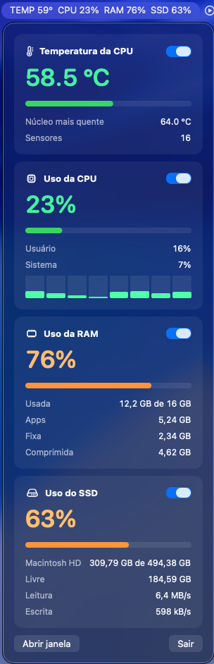

# MacVitals

App para macOS que mostra os sinais vitais do Mac na barra de menus e numa janela:

- **Temperatura da CPU**: média dos sensores dos núcleos e o núcleo mais quente
- **Uso da CPU**: total, usuário, sistema e o uso de cada núcleo
- **Uso da RAM**: memória usada, com a mesma divisão do Monitor de Atividade (apps, fixa e comprimida)
- **Uso do SSD**: espaço ocupado no volume de inicialização e velocidade de leitura e escrita

  

Cada métrica tem um interruptor no cartão. Ele define se a métrica aparece na barra de menus, por exemplo `TEMP 57°  CPU 24%  RAM 75%  SSD 63%`. A escolha fica salva entre execuções.

## Requisitos

- Mac com Apple Silicon (M1 ou mais novo)
- macOS 26.2 ou mais novo
- Xcode 26.2 ou mais novo, para compilar

## Como compilar

1. Clone o repositório e abra o `MacVitals.xcodeproj`.
2. Em **Target MacVitals → Signing & Capabilities**, troque o **Team** pelo seu.
3. Rode com ⌘R.

## Como funciona

| Métrica | Fonte |
|---|---|
| Temperatura | Sensores HID do IOKit (`PMU tdie*` no M2 em diante, `pACC/eACC MTR` no M1) |
| CPU | `host_processor_info`, pela diferença de ticks entre duas leituras |
| RAM | `host_statistics64` |
| SSD | Capacidade do volume `/` e contadores do `IOBlockStorageDriver` (só discos internos) |

As leituras se repetem a cada 2 segundos.

### Limitações

- A leitura de temperatura usa funções privadas do IOKit, declaradas em `MacVitals-Bridging-Header.h`. Por isso o app roda **sem sandbox** e não pode ser publicado na App Store.
- Uma atualização do macOS pode mudar ou remover essas funções sem aviso.
- O app não tem assinatura nem notarização da Apple. Se você distribuir o `.app` já compilado, o macOS bloqueia a abertura em outros Macs. Para liberar, clique com o botão direito no app e escolha **Abrir**, ou vá em **Ajustes do Sistema → Privacidade e Segurança**.

## Créditos

A forma de ler os sensores segue o [Stats](https://github.com/exelban/stats), de Serhiy Mytrovtsiy, distribuído sob a licença MIT.

## Licença

[MIT](LICENSE)
